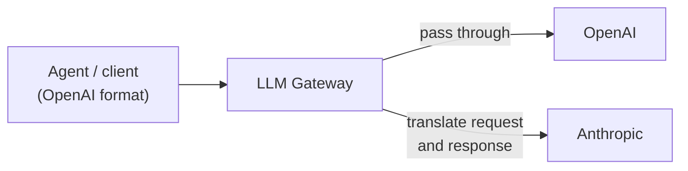

# LLM Gateway

A proof of concept of the core idea behind OpenRouter: **one OpenAI-compatible API in front of several LLM providers**. Clients speak the OpenAI Chat Completions format; the gateway routes each request to OpenAI or Anthropic and translates to and from the Anthropic Messages format when needed.

It is written in C# as a single ASP.NET Core minimal API (.NET 10) with no external packages, and it is complete enough to drive a real tool-calling AI agent ([Hermes Agent](https://hermes-agent.nousresearch.com/)) on Claude models through an OpenAI-only interface.

> This is an experiment, not a production service. See [Limitations](#limitations).

## How it works



The client only changes the `model` name. Everything else in the request stays the same, including when switching between providers.

## Features

- **OpenAI-compatible endpoints**: `POST /v1/chat/completions` and `GET /v1/models`.
- **Routing by model name**: OpenAI models are forwarded as-is; Anthropic models are converted to the Messages API and the response is converted back.
- **Tool calling across providers**, in both directions and across multiple turns:
  - tool definitions (`tools[].function` → `name` / `description` / `input_schema`)
  - tool calls (`tool_use` blocks ↔ `tool_calls`, including `input` object ↔ `arguments` JSON string)
  - tool results (`role: "tool"` messages → `tool_result` blocks; consecutive results are merged into one user message)
- **Response normalisation**: `stop_reason` → `finish_reason`, token usage, and an OpenAI-style `model_not_found` error for unknown models.
- **Automatic model selection**: `auto-cheap` picks the model with the lowest input price, `auto-smart` the highest.
- **Cost logging**: every successful request logs its token counts and cost to the console.
- **Fake streaming**: when the client sends `stream: true`, the gateway calls the provider without streaming and returns the full answer as a single SSE chunk followed by `[DONE]`. This is enough for clients that only accept streamed responses.

## Models

The model list and prices are hardcoded in [Program.cs](Program.cs). Prices are USD per 1M tokens.

| Model | Provider | Input | Output |
|---|---|---|---|
| `gpt-5-nano` | OpenAI | $0.05 | $0.40 |
| `gpt-6-luna` | OpenAI | $0.10 | $0.50 |
| `gpt-6.1-terra` | OpenAI | $1.00 | $5.00 |
| `claude-haiku-5-5` | Anthropic | $0.10 | $0.50 |
| `claude-sonnet-5-5` | Anthropic | $2.00 | $10.00 |
| `auto-cheap` | gateway | resolves to the cheapest model | |
| `auto-smart` | gateway | resolves to the most expensive model | |

## Getting started

Requirements: the [.NET 10 SDK](https://dotnet.microsoft.com/download) and an API key for each provider you want to use.

Set the keys as environment variables.

PowerShell:

```powershell
$env:OPENAI_API_KEY = "sk-..."
$env:ANTHROPIC_API_KEY = "sk-ant-..."
```

bash:

```bash
export OPENAI_API_KEY="sk-..."
export ANTHROPIC_API_KEY="sk-ant-..."
```

Run the gateway:

```bash
dotnet run
```

It listens on `http://localhost:5239`.

## Usage

Send a chat completion:

```bash
curl http://localhost:5239/v1/chat/completions \
  -H "Content-Type: application/json" \
  -d '{
    "model": "gpt-5-nano",
    "messages": [{ "role": "user", "content": "Hello!" }]
  }'
```

To use Claude instead, change only the model name:

```json
"model": "claude-haiku-5-5"
```

List the available models:

```bash
curl http://localhost:5239/v1/models
```

Each request prints a line like this in the gateway console:

```
Model:claude-sonnet-5-5 prompt: 12 completion: 13 cost: 0.000154
```

The `req*.json` files in the repository root are sample requests (plain chat, tool definitions, and tool call history) that were used during development.

## Using it with Hermes Agent

1. In the Hermes provider setup, choose **Custom endpoint (enter URL manually)**.

   

2. Enter `http://localhost:5239/v1` as the API base URL.

   

3. Pick the `chat_completions` API mode and select a model. The list comes from the gateway's `/v1/models`.

   

4. Enable the tools you want the agent to use. Tool calls then go through the gateway, whichever provider serves the model.

   

## A finding from the cost log

List price is a poor predictor of what a request costs. Sending the same `Hello!` to two models:

| | `gpt-5-nano` | `claude-sonnet-5-5` |
|---|---|---|
| Output price per 1M tokens | $0.40 | $10.00 |
| Output tokens used | 177 – 407 | 13 |
| Cost per request | $0.00007 – $0.00016 | $0.00015 |

`gpt-5-nano` spends about three quarters of its output tokens on reasoning before it answers, and those tokens are billed. Over 13 runs it was only about 20% cheaper on average, and more expensive twice, despite a 25× lower list price.

## Limitations

- No real streaming. Streamed responses arrive all at once, after the provider has finished.
- No authentication. The gateway uses its own provider keys for every caller, so do not expose it publicly.
- No failover between providers.
- For Anthropic models, only the fields the gateway converts are sent: model, messages, tools, and the token limit (default 1024 when the client sets none). Other parameters such as `temperature` are dropped, and system and tool message content must be a plain string.
- Models and prices are hardcoded.

## Further reading

[doc/concept.md](doc/concept.md) explains the idea and the translation problems in more detail (in Thai).
