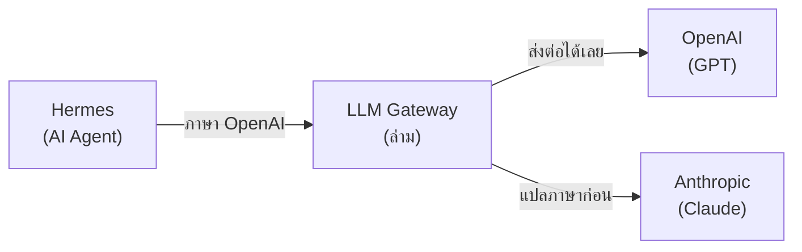
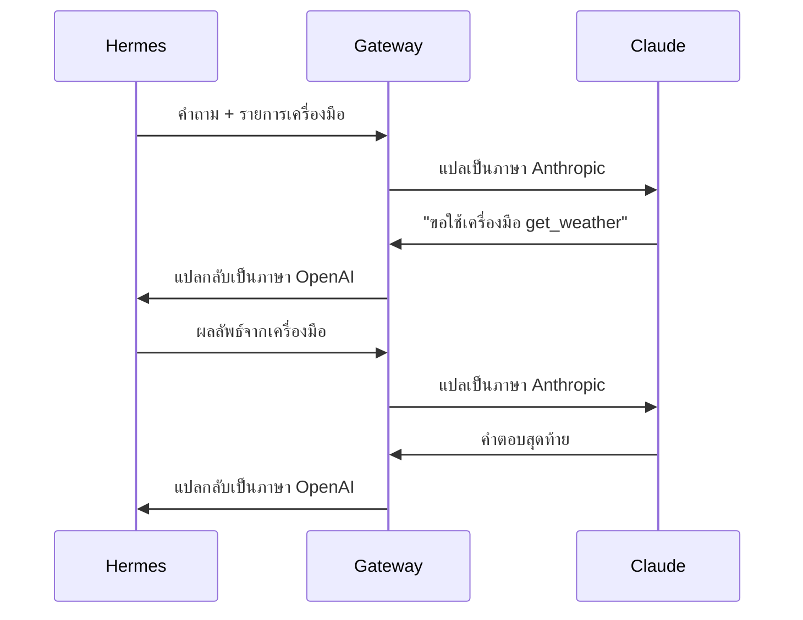
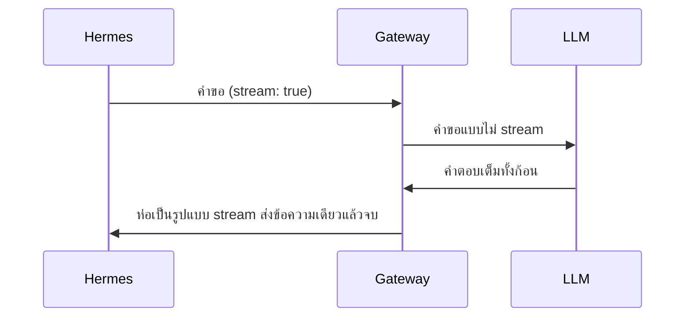

# LLM Gateway — ทดสอบไอเดียหลักของ OpenRouter

## 1. โปรเจกต์นี้คืออะไร

**OpenRouter** คือบริการที่ให้เราคุยกับ AI หลายค่าย (OpenAI, Anthropic ฯลฯ) ผ่าน "ประตูเดียว"

โปรเจกต์นี้พิสูจน์ว่า **สร้างประตูแบบเดียวกับ OpenRouter ได้เอง** และใช้ได้จริงกับ AI Agent ไม่ใช่แค่แชตถามตอบ

---

## 2. ภาพรวม

AI แต่ละค่าย "พูดคนละภาษา" Gateway ทำหน้าที่เป็น **ล่าม** ที่ยืนตรงกลาง



- Agent พูดภาษาเดียวตลอด
- Gateway เลือกค่ายปลายทาง และแปลไปกลับให้เอง

---

## 3. ทดสอบอย่างไร

ให้ **Hermes** (AI Agent ของจริง) เชื่อมต่อกับ Gateway แทนการต่อตรงไปที่ OpenAI

อยากสลับ model แก้แค่บรรทัดเดียว:

```json
{
  "model": "gpt-5-nano",
  "messages": [{ "role": "user", "content": "สวัสดี" }]
}
```

```json
{
  "model": "claude-haiku-5-5",
  "messages": [{ "role": "user", "content": "สวัสดี" }]
}
```

- เปลี่ยนแค่ชื่อ `model` ที่เหลือเหมือนเดิมทุกตัวอักษร
- สลับข้ามค่ายจาก GPT ไป Claude ได้ โดยไม่ต้องแก้ตัว Agent

---

## 4. จุดที่ยาก และทำสำเร็จ

### 4.1 แปลการ "เรียกใช้เครื่องมือ" ข้ามค่าย — ยากที่สุด

Agent ต่างจากแชตธรรมดา เพราะมัน **สั่งงานเครื่องมือได้** เช่น อ่านไฟล์ ค้นข้อมูล แล้วนำผลกลับมาคิดต่อ



ต้องแปลทั้งขาไปและขากลับ ทุกรอบ

---

**ตัวอย่าง: AI ขอใช้เครื่องมือดูอากาศ** — ความหมายเดียวกัน แต่เขียนคนละแบบ

แบบ Anthropic (สิ่งที่ Claude ตอบมา):

```json
{
  "type": "tool_use",
  "id": "call_1",
  "name": "get_weather",
  "input": { "city": "Bangkok" }
}
```

แบบ OpenAI (สิ่งที่ Hermes ต้องการ):

```json
{
  "type": "function",
  "id": "call_1",
  "function": {
    "name": "get_weather",
    "arguments": "{\"city\":\"Bangkok\"}"
  }
}
```

- ชื่อช่องต่างกัน: `input` กับ `arguments`
- โครงสร้างต่างกัน: ฝั่ง OpenAI ซ้อนอยู่ใน `function` อีกชั้น
- ชนิดข้อมูลต่างกัน: ฝั่ง OpenAI เป็น **ข้อความ** ฝั่ง Anthropic เป็น **ข้อมูลจริง**

---

ต้องแปลให้ถูกครบทั้ง 3 ส่วน:

| ส่วนที่ต้องแปล | ความหมาย |
|---|---|
| รายการเครื่องมือ | บอก AI ว่ามีเครื่องมืออะไรให้ใช้ |
| คำสั่งใช้เครื่องมือ | AI ตอบว่า "ขอใช้เครื่องมือนี้" |
| ประวัติผลลัพธ์ | ผลจากเครื่องมือ ที่ส่งกลับไปให้ AI คิดต่อ |

**แปลผิดจุดเดียว Agent หยุดทำงานทันที** — การที่ Hermes ทำงานผ่าน Claude ได้ต่อเนื่องหลายรอบ คือหลักฐานว่าแปลถูก

---

### 4.2 Agent แยกไม่ออกว่าไม่ได้คุยกับ OpenAI

คำตอบของ Claude ถูกแปลงกลับเป็นรูปแบบ OpenAI ทั้งหมด:

- เนื้อหาคำตอบ
- เหตุผลที่ AI หยุดตอบ
- จำนวน token ที่ใช้
- ข้อความแจ้งข้อผิดพลาด เมื่อไม่พบ model

### 4.3 เลือก model ให้อัตโนมัติ

| ชื่อที่ส่งมา | Gateway เลือกให้ |
|---|---|
| `auto-cheap` | model ที่ราคาถูกที่สุด |
| `auto-smart` | model ระดับสูงสุด (วัดจากราคา) |

### 4.4 คิดค่าใช้จ่ายทุกคำขอ

บันทึกจำนวน token และคำนวณต้นทุนของทุกคำขอ — พื้นฐานของการคิดเงินลูกค้าแบบที่ OpenRouter ทำ

**สิ่งที่พบจากการวัดจริง: ราคาป้ายถูกกว่า 25 เท่า แต่จ่ายจริงเกือบเท่ากัน**

ส่งข้อความ `Hello!` เหมือนกันไปที่ model สองตัว:

| | gpt-5-nano | claude-sonnet-5-5 |
|---|---|---|
| ราคาป้าย (ต่อ 1 ล้าน token ขาออก) | $0.40 | $10.00 |
| token ขาออกที่ใช้จริง | 177 – 407 | 13 |
| ต้นทุนจริงต่อคำขอ | $0.00007 – $0.00016 | $0.00015 |

```
Model:gpt-5-nano prompt: 8 completion: 407 cost: 0.0001632
Model:claude-sonnet-5-5 prompt: 12 completion: 13 cost: 0.000154
```

- gpt-5-nano ใช้ token ไปกับการ "คิดในใจ" ก่อนตอบ ประมาณ 3 ใน 4 ของ token ขาออก ซึ่งต้องจ่ายเงินทั้งหมด
- จาก 13 ครั้ง gpt-5-nano เฉลี่ยถูกกว่าเพียง ~20% และ **แพงกว่า 2 ครั้ง**
- ดูราคาป้ายอย่างเดียวไม่พอ ต้องวัดต้นทุนจริงทุกคำขอ Gateway จึงต้องมีส่วนนี้

### 4.5 Streaming แบบจำลอง (fake stream)

Hermes ต้องการรับคำตอบแบบ streaming เท่านั้น ถ้าตอบกลับเป็น JSON ธรรมดาจะใช้งานไม่ได้

Gateway จึงทำ **fake stream**:



- Gateway เรียก LLM แบบปกติ (ไม่ stream) แล้วรอจนได้คำตอบครบ
- นำคำตอบทั้งหมดมาห่อเป็นรูปแบบ stream ส่งกลับใน **ข้อความเดียว** แล้วปิดทันทีด้วย `[DONE]`
- Hermes ทำงานได้ตามปกติ เพราะรูปแบบที่ได้รับถูกต้องตามที่คาดไว้
- ข้อจำกัด: ผู้ใช้ไม่เห็นคำตอบทยอยขึ้นทีละคำ ต้องรอจนคำตอบเสร็จทั้งหมดก่อน

---

## 5. สิ่งที่ยังไม่ได้ทำ

นี่คือการทดสอบไอเดีย ยังไม่ใช่ระบบพร้อมใช้งานจริง

- Streaming ของจริงที่ทยอยส่งทีละคำ (ตอนนี้เป็น fake stream ตามข้อ 4.5)
- API Key แยกรายผู้ใช้
- สลับค่ายอัตโนมัติเมื่อค่ายหนึ่งล่ม

---

## 6. สรุป

ไอเดียหลักของ OpenRouter คือ **API เดียว ใช้ได้หลายค่าย สลับ model ได้อิสระ**

โปรเจกต์นี้พิสูจน์ว่าทำได้จริง รวมถึงส่วนที่ยากที่สุด คือการรองรับ AI Agent ที่เรียกใช้เครื่องมือข้ามค่าย

เขียนด้วย C# (.NET)
